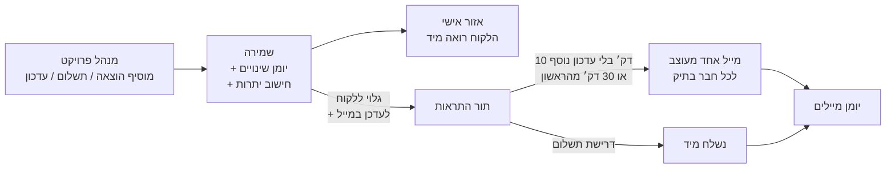

# אפיון: תיקי לקוחות ואזור אישי

**דירומקס · ניהול השבחת נכסים**
גרסה 1.2 · 18.11.2026 · סטטוס: שלב 1 באוויר בענף הראשי, שלב 2 בפיתוח

> **רמת סיכון 3** לפי סעיף 3.1 בתקן Multi Digital: מידע פיננסי של לקוחות פרטיים. מכאן: מסמכים מוצפנים במנוחה, MFA למנהלים, ומבדק חדירה חיצוני לפני עלייה לאוויר. פירוט בסעיף 9.

> מוקאפים: [`portal-mockup.html`](portal-mockup.html) — האזור האישי של הלקוח · [`email-mockup.html`](email-mockup.html) — מייל העדכון ללקוח.
> לפתוח בדפדפן. אותם מספרים מופיעים בשניהם ובדוגמת החישוב בסעיף 5.

---

## תקציר

לכל לקוח יש **תיק דיגיטלי**: ההסכם, התקציב, כל הוצאה, כל תשלום, דרישות התשלום, המסמכים ועדכוני ההתקדמות לאורך שבעת שלבי התהליך.

- **מנהל הפרויקט** מזין בלוח הניהול: הוצאה, תשלום, דרישת תשלום, עדכון, מסמך.
- **הלקוח** רואה את אותם נתונים בדיוק, באזור אישי באתר, ברגע שהם נשמרים. מקור אמת אחד, אין העתקות ואין "גרסה ללקוח".
- **בכל עדכון נשלח ללקוח מייל מעוצב** במיתוג של דירומקס, עם הפריט החדש, המצב הכספי המעודכן וכפתור לתיק המלא. כמה עדכונים רצופים מתאחדים למייל אחד.

זה מממש בפועל את ההבטחות שכבר כתובות באתר: *"אתה מקבל דיווח, לא משימות"*, *"תוכנית, בקרה ודיווח שוטף על מה שקורה בפועל"*, *"אתה רואה אותו (את שכר הניהול) בתקציב מהיום הראשון"*.

---

## 1. מטרות ומה לא נכלל

### מטרות

1. **שקיפות מלאה ללקוח.** תקציב מול ביצוע, כל הוצאה עם מסמך, יתרה עדכנית, בלי לבקש ובלי לחכות.
2. **פחות שיחות "מה המצב?".** הלקוח מקבל עדכון יזום על כל אירוע, והתשובה לכל שאלה נמצאת באזור האישי.
3. **הזנה מהירה למנהל הפרויקט.** הוצאה חדשה נכנסת תוך פחות מ-30 שניות, כולל צירוף חשבונית.
4. **תיעוד שמחזיק גם במחלוקת.** כל שינוי בנתון כספי נרשם: מי, מתי, מה היה ומה נהיה. שום תנועה לא נמחקת, היא רק מבוטלת.
5. **אותו תקן כמו האתר.** בלי תוספים ובלי ספריות צד ג', נגישות לפי WCAG 2.2 AA ות"י 5568, ואבטחה ברמה של מידע פיננסי.

### מה לא נכלל (במכוון)

| לא נכלל | למה |
|---|---|
| הנהלת חשבונות והפקת חשבוניות מס / קבלות | זה תפקיד של תוכנת הנה"ח. המערכת מתעדת ומדווחת. "אישור קבלת תשלום" שנשלח ללקוח **אינו קבלה**. אין אינטגרציה לתוכנת הנה"ח (החלטה 11). |
| תשלום אונליין בכרטיס אשראי | נכנס בשלב 3. בשלב 1 דרישת התשלום כוללת פרטי העברה בנקאית. |
| חתימה דיגיטלית מחייבת על ההסכם | ההסכם נחתם כמו היום ומועלה כ-PDF. אישור קריאה באזור האישי נכנס בשלב 2, וחתימה מחייבת בשלב 3. |
| צ'אט בזמן אמת | ערוץ התקשורת נשאר טלפון, וואטסאפ ומענה למייל, שמגיע ישירות למנהל הפרויקט. |
| אפליקציה | האזור האישי בנוי כאתר מותאם למובייל. |

---

## 2. משתמשים והרשאות

| תפקיד | מי | רואה | יכול |
|---|---|---|---|
| **מנהל מערכת** | בעלי דירומקס | הכל | הכל, כולל הגדרות, שיוך מנהלי פרויקטים ותיקים סגורים |
| **מנהל פרויקט** (`dx_manager`) | עובד/ת | את התיקים ששויכו אליו/ה | פתיחת תיק, הזמנת לקוחות, הזנת תנועות, עדכונים ומסמכים, שליחת מיילים. **לא מוחק תנועה** אלא מבטל אותה עם סיבה. |
| **לקוח** (`dx_client`) | בעל/ת הנכס, שותפים, יורשים | רק תיקים שהוא חבר בהם, ורק פריטים שסומנו "גלוי ללקוח" | צפייה, הורדת מסמכים, הדפסה/ייצוא. אין לו גישה ללוח הניהול של וורדפרס. |

**כמה לקוחות לתיק, כמה תיקים ללקוח.** נכס בירושה או בבעלות משותפת שייך לכמה אנשים, ולקוח אחד יכול להחזיק כמה נכסים. לכן החברות בתיק היא קשר רבים-לרבים, ולכל חבר:

- **תפקיד בתיק:** בעלים / שותף / צופה (למשל בן משפחה או עו"ד שמלווה). בשלב 1 כולם רואים אותו דבר. ההבחנה נשמרת לשלב 2 (מי מאשר החלטות).
- **מקבל מיילים:** כן / לא.
- **נראה לאחרונה:** מתי נכנס בפעם האחרונה. מוצג למנהל הפרויקט.

---

## 3. מושגים

| מושג | הגדרה |
|---|---|
| **תיק** | נכס אחד בתהליך השבחה. כולל כתובת, סוג נכס, מסלול, שלב נוכחי, מנהל פרויקט, תנאי שכר ניהול וסטטוס (פעיל / מושהה / סגור). |
| **הסכם** | ה-PDF החתום ותקציר התנאים: תאריך חתימה, היקף העבודה, מסלול ושכר ניהול. כולל נספחים, כל אחד כגרסה נפרדת. |
| **תקציב** | סעיפי תקציב מתוכננים. כל הוצאה משויכת לסעיף, וכך נוצרת השוואה של תקציב מול ביצוע. |
| **תנועה** | שורה כספית. ארבעה סוגים, ראו טבלה מתחת. |
| **מקור מימון** | מאיפה יצא הכסף להוצאה. זה מה שקובע את היתרה (ראו סעיף 5). |
| **עדכון** | טקסט חופשי מהשטח, עם תמונות או מסמכים ועם מעבר שלב אופציונלי. |
| **מסמך** | קובץ פרטי בתיק: הסכם, נספח, הצעת מחיר, חשבונית, היתר, תוכנית, צילום. |

### סוגי תנועות

| סוג | מה זה | שדות עיקריים | סטטוסים |
|---|---|---|---|
| **הוצאה** | כסף ששולם (או התחייבות לשלם) לספק לטובת הפרויקט | תאריך, סעיף תקציב, ספק, תיאור, סכום לפני מע"מ, מע"מ, סה"כ, מקור מימון, מסמך מצורף | `התחייבות` (הסכם או הצעה חתומים, טרם שולם) ← `שולם` |
| **תשלום מהלקוח** | כסף שהלקוח העביר לחשבון הפרויקט | תאריך, סכום, אמצעי (העברה / צ'ק / אשראי), אסמכתא, דרישת תשלום מקושרת, אישור העברה | `התקבל` |
| **דרישת תשלום** | בקשה מהלקוח לשלם סכום עד תאריך, **לספק ישירות או לדירומקס** | סכום, מועד, למי משלמים (ספק או דירומקס), עבור מה, פרטי תשלום, מסמך (למשל חשבונית הספק) | `פתוחה` ← `שולמה`, וכן `באיחור` (מחושב) או `בוטלה` |
| **החזר ללקוח** | כסף שהוחזר ללקוח מחשבון הפרויקט | תאריך, סכום, אסמכתא | `בוצע` |

**לכל תנועה גם:** גלוי ללקוח (כן/לא), הערה פנימית שלא מוצגת ללקוח לעולם, נוצר/עודכן על ידי ומתי.

**סגירת דרישת תשלום.** כשמנהל הפרויקט מסמן דרישה כ"שולמה", נוצרת אוטומטית התנועה המתאימה ומקושרת אליה: דרישה לספק הופכת ל**הוצאה** שמקורה "הלקוח ישירות", ודרישה לדירומקס הופכת ל**תשלום מהלקוח** לחשבון הפרויקט. כך אין הזנה כפולה.

**תיקון ומחיקה:**
- כל עוד התנועה לא נחשפה ללקוח, אפשר לערוך אותה בחופשיות.
- אחרי שנחשפה, עריכה נרשמת ביומן השינויים, ומנהל הפרויקט בוחר אם לעדכן את הלקוח ("עודכנה הוצאה").
- **אין מחיקה.** תנועה מבוטלת עם סיבה, יוצאת מכל החישובים, ומוצגת ללקוח מחוקה בקו עם הסיבה. כך שומרים על שקיפות.

### סעיפי תקציב ברירת מחדל

ניתנים לעריכה בהגדרות. לכל תיק בוחרים את הסעיפים הרלוונטיים:

בדיקות ומידע תכנוני · אדריכלות ותכנון · יועצים ומדידות · אגרות והיטלים · שכנים והסכמות · ביצוע (קבלן ראשי) · ביצוע (ספקים וקבלני משנה) · פיקוח · משפטי ורישום · שיווק ומכירה · שכר ניהול דירומקס · רזרבה לבלתי צפוי

### שבעת השלבים

שמות השלבים נלקחים **מהתוכן של האתר עצמו** (`improve.steps` בעורך התוכן), כך שהלקוח רואה באזור האישי בדיוק את מה שקרא בעמוד הבית: 01 בדיקת פוטנציאל וזכויות ← 02 אסטרטגיה ותוכנית עבודה ← 03 ליווי תכנוני ← 04 החתמת שכנים ← 05 הוצאת היתר ← 06 ניהול ביצוע ← 07 שיווק ומכירה.

לכל שלב: סטטוס (טרם התחיל / בתהליך / הושלם / לא רלוונטי), ותאריכי התחלה וסיום. לא כל תיק עובר את כל השלבים (למשל הסדרת חריגה בלי מכירה), ולכן שלב יכול להיות מסומן "לא רלוונטי".

---

## 4. איך זה עובד: הזרימה



**"מסונכרן עם הלקוח" אומר:** אין שלב ייצוא ואין "פרסום". האזור האישי קורא מאותן טבלאות שמנהל הפרויקט כותב אליהן. מה שסומן "גלוי ללקוח" מופיע בטעינה הבאה של העמוד.

---

## 5. המודל הכספי

כל הסכומים נשמרים **באגורות, כמספר שלם** (`BIGINT`). אין חישובי נקודה צפה, ולכן 0.1 + 0.2 לא יוצא 0.30000000000000004. המטבע ₪. שיעור המע"מ מוגדר בהגדרות ונשמר על כל תנועה בזמן ההזנה, כך ששינוי עתידי בשיעור לא משנה היסטוריה.

### מקורות מימון להוצאה

| מקור | פירוש | משפיע על יתרת חשבון הפרויקט? |
|---|---|---|
| **חשבון הפרויקט** | דירומקס שילמה מכספים שהלקוח העביר, או הקדימה תשלום | כן, מוריד |
| **הלקוח ישירות** (ברירת המחדל) | הלקוח שילם לספק בעצמו, וההוצאה מתועדת לצורך התמונה המלאה. **זה המצב ברוב התיקים.** | לא |
| **מתוך התמורה** | נדחה לפירעון מכספי המכירה (מסלול "מימון מתוך הפרויקט", ושכר הניהול) | לא, נצבר כ"לפירעון מהתמורה" |
| **שותף משביח** | גורם מממן שנושא בעלות וחולק ברווח | לא, נצבר בנפרד |

**יתרת חשבון הפרויקט מוצגת רק כשיש בה תנועה.** בתיק שבו הלקוח משלם רק ישירות לספקים, אין חשבון פרויקט, והקוביה הזו לא מוצגת ללקוח.

### מה מחושב ומוצג

| מדד | נוסחה |
|---|---|
| תקציב מאושר | Σ סעיפי התקציב |
| עלות עד היום | Σ הוצאות בסטטוס `שולם`, מכל המקורות |
| התחייבויות פתוחות | Σ הוצאות בסטטוס `התחייבות` |
| צפי עלות | עלות עד היום + התחייבויות פתוחות |
| ניצול תקציב | עלות עד היום ÷ תקציב מאושר (ובנפרד: צפי ÷ תקציב) |
| יתרה בחשבון הפרויקט | Σ תשלומי לקוח − Σ החזרים − Σ הוצאות ששולמו מחשבון הפרויקט. **חיובי** = כסף זמין. **שלילי** = דירומקס הקדימה, והלקוח חייב. |
| לפירעון מהתמורה | Σ הוצאות שמקורן "מתוך התמורה" |
| לתשלום כעת | Σ יתרות של דרישות תשלום פתוחות, והקרובה שבהן מודגשת |

### דוגמה, אותם מספרים כמו במוקאפים

| תאריך | סוג | תיאור | מקור | סכום |
|---|---|---|---|---|
| 11.07.2026 | הוצאה | מדידה ומפת מצב | הלקוח ישירות | 4,500 ₪ |
| 20.07.2026 | תשלום | העברה בנקאית | | 60,000 ₪ |
| 02.08.2026 | הוצאה | תכנון אדריכלי, שלב א׳ | חשבון הפרויקט | 38,000 ₪ |
| 15.09.2026 | הוצאה | שכר ניהול, שלב התכנון | מתוך התמורה | 24,000 ₪ |
| 28.10.2026 | התחייבות | הסכם קבלן, מקדמה | חשבון הפרויקט | 45,000 ₪ |
| 05.11.2026 | דרישת תשלום | מקדמה לשלב הביצוע, עד 01.12.2026 | | 40,000 ₪ |
| 12.11.2026 | הוצאה | אגרת בקשה להיתר | חשבון הפרויקט | 12,300 ₪ |

תקציב מאושר 480,000 ₪ ←
**עלות עד היום** 4,500 + 38,000 + 24,000 + 12,300 = **78,800 ₪** (16.4%) ·
**התחייבויות** 45,000 ₪ · **צפי** 123,800 ₪ (25.8%) ·
**יתרה בחשבון הפרויקט** 60,000 − 38,000 − 12,300 = **9,700 ₪** ·
**לפירעון מהתמורה** 24,000 ₪ · **לתשלום כעת** 40,000 ₪ עד 01.12.2026.

### שכר ניהול

נקבע בהסכם, באחד משלושה אופנים: אחוז מהתקציב, סכום קבוע, או אחוז מהרווח במכירה. מופיע ללקוח כסעיף תקציב רגיל מהיום הראשון, כמו שהאתר מבטיח. החיובים בפועל נרשמים כהוצאות בסעיף "שכר ניהול דירומקס", בדרך כלל עם מקור "מתוך התמורה".

---

## 6. לוח הניהול: מסכי מנהל הפרויקט

תפריט חדש בלוח הניהול: **תיקי לקוחות**.

### 6.1 רשימת התיקים

טבלה עם חיפוש וסינון לפי סטטוס, מנהל פרויקט ושלב.

| עמודה | |
|---|---|
| תיק | כתובת הנכס ומספר תיק (`2026-014`) |
| לקוחות | שמות החברים בתיק |
| שלב | `05 · הוצאת היתר` |
| ניצול תקציב | פס התקדמות ואחוז |
| יתרה | צבע ותווית טקסט: זמין / חוב |
| לתשלום | סכום פתוח, ואם יש איחור: "באיחור X ימים" |
| עדכון אחרון | לפני כמה ימים, כדי לזהות תיק שלא דווח עליו |
| נכנס לאחרונה | מתי הלקוח צפה בתיק |

### 6.2 מסך תיק

ראש המסך: כתובת, לקוחות, שלב, מנהל פרויקט וכפתור **"צפייה כלקוח"**, שפותח את האזור האישי בדיוק כפי שהלקוח רואה אותו.

לשוניות:

1. **סקירה:** מדדי סעיף 5, דרישות תשלום פתוחות, פעילות אחרונה, **מיילים שממתינים לשליחה**.
2. **פרטי התיק:** כתובת, סוג נכס, מסלול, כלי ההשבחה (הוספת יחידה / פיצול / ממ"ד…), שלבים ותאריכים.
3. **לקוחות:** הוספת חבר (שם, דוא"ל, טלפון, תפקיד, מקבל מיילים), שליחת הזמנה מחדש, הסרה.
4. **הסכם:** העלאת PDF ותקציר תנאים, נספחים כגרסאות.
5. **תקציב:** סעיפים וסכומים, ושינוי תקציב נרשם ביומן.
6. **כספים:** כל התנועות וטופס הוספה מהירה (ראו 6.3).
7. **עדכונים:** כתיבת עדכון, צירוף תמונות ומעבר שלב.
8. **מסמכים:** העלאה, סיווג וגלוי ללקוח כן/לא.
9. **יומן:** כל שינוי וכל מייל שנשלח, עם סטטוס מסירה.

### 6.3 הוספה מהירה של תנועה

טופס אחד בראש לשונית הכספים. בחירת הסוג מציגה רק את השדות הרלוונטיים:

```
[ הוצאה ▾ ]  תאריך [12.11.2026]  סעיף [אגרות והיטלים ▾]  ספק [ועדה מקומית קריית אונו]
תיאור [אגרת בקשה להיתר]   סכום [12,300]  ☐ כולל מע"מ   מקור [חשבון הפרויקט ▾]   סטטוס [שולם ▾]
מסמך [⇪ גרירת קובץ]       הערה פנימית [...]
☑ גלוי ללקוח   ☑ לעדכן את הלקוח במייל          [ תצוגה מקדימה של המייל ]  [ שמירה ]
```

- השמירה בלי רענון עמוד, וגם בלי JavaScript היא עובדת כטופס רגיל, כמו טופס הלידים באתר.
- אחרי שמירה הטופס מתאפס ונשאר פתוח לתנועה הבאה. הזנה של כמה חשבוניות ברצף היא התרחיש הנפוץ.
- **ספקים** נשמרים לרשימת השלמה אוטומטית, כדי שלא יקלידו אותם מחדש.
- **"תצוגה מקדימה של המייל"** מציגה בדיוק את מה שיישלח, ומאפשרת לשלוח בדיקה לעצמך.

### 6.4 מיילים ממתינים

בלשונית הסקירה ובראש מסך התיק:

> ✉ 2 עדכונים ממתינים לשליחה ללקוחות התיק · יישלחו ב-14:32 · [שליחה עכשיו] [ביטול]

---

## 7. האזור האישי של הלקוח

כתובת: `/portal/` (ניתן לשינוי). מוצג בתוך ההדר והפוטר של האתר, באותה שפה עיצובית: גבולות 2px, בלי פינות מעוגלות, הכחול, הכתום והטורקיז. ההדר מקבל קישור "אזור אישי".

### 7.1 כניסה

1. הלקוח מזין דוא"ל ומקבל **קישור כניסה חד-פעמי** (תקף 15 דקות). לא צריך לזכור סיסמה, וזה מתאים לקהל שנכנס פעם בשבועיים.
2. *שלב 2:* סיסמה למי שמעדיף. היא תיבנה לפי סעיף 4.5 בתקן: 15 תווים לפחות ובדיקה מול סיסמאות דלופות.
3. ההודעה אחרי שליחה זהה תמיד: *"אם הכתובת רשומה אצלנו, נשלח אליה קישור"*. כך אי אפשר לברר מי לקוח של דירומקס.
4. הקישור מהמייל הראשון (ההזמנה) תקף 72 שעות.
5. "זכור אותי" שומר את הכניסה 14 יום.

### 7.2 המסכים

**התיקים שלי.** מוצג רק כשללקוח יש יותר מתיק אחד. אחרת נכנסים ישר לתיק.

**תיק** (מוקאפ: `portal-mockup.html`):

1. **ראש התיק:** כתובת, מה עושים בנכס, מסלול, וכרטיס מנהל הפרויקט עם טלפון, וואטסאפ ודוא"ל.
2. **מד שלבים:** שבעת השלבים, עם סימון לשלבים שהושלמו ולשלב הנוכחי.
3. **פס דרישת תשלום:** מופיע רק כשיש דרישה פתוחה. סכום, מועד ופרטי העברה עם כפתור העתקה.
4. **חמש קוביות מדדים:** תקציב מאושר · עלות עד היום (עם פס ניצול) · התחייבויות פתוחות · יתרה בחשבון הפרויקט · לפירעון מהתמורה.
5. **לשוניות:**
   - **כספים:** טבלת כל התנועות עם סינון לפי סוג, סעיף וטווח תאריכים, שורת סיכום, ואייקון מסמך בכל שורה שיש לה קובץ. מתחת: **תקציב מול ביצוע** לפי סעיף.
   - **הסכם ומסמכים:** כרטיס ההסכם עם תקציר התנאים והורדה, ורשימת מסמכים לפי סוג.
   - **עדכונים:** ציר זמן, מהחדש לישן, עם תמונות.
6. **הדפסה / PDF:** גיליון סגנון להדפסה שמייצר דוח מסודר דרך "הדפסה ← שמירה כ-PDF" של הדפדפן, בלי ספרייה.

**במובייל:** הטבלה הופכת לכרטיסים (שורה = כרטיס), הקוביות נערמות, והלשוניות נגללות אופקית.

### 7.3 מה הלקוח לא רואה, אף פעם

הערות פנימיות · תנועות שסומנו "לא גלוי" · יומן השינויים המלא (רואה רק "בוטל" ואת הסיבה) · רשימת לקוחות של תיקים אחרים · לוח הניהול של וורדפרס.

---

## 8. המיילים

### 8.1 מתי נשלח מה

| אירוע | נשלח | נושא המייל |
|---|---|---|
| לקוח נוסף לתיק | **מיד** | הוזמנת לאזור האישי של דירומקס · {כתובת} |
| בקשת קישור כניסה | **מיד** | קישור כניסה לאזור האישי · דירומקס |
| הוצאה חדשה / עודכנה | מאוחד | הוצאה חדשה בתיק {כתובת}: {סכום} |
| תשלום התקבל | מאוחד | קיבלנו את התשלום · {סכום} · {כתובת} |
| **דרישת תשלום** | **מיד** | דרישת תשלום: {סכום} עד {תאריך} · {כתובת} |
| עדכון התקדמות | מאוחד | עדכון מהשטח · {כתובת} |
| מעבר שלב | מאוחד | התקדמנו לשלב {מס׳}: {שם השלב} |
| הסכם / נספח / מסמך חדש | מאוחד | מסמך חדש בתיק: {שם המסמך} |
| כמה אירועים מאוחדים | | {n} עדכונים חדשים בתיק {כתובת} |
| *שלב 2:* תזכורת תשלום | אוטומטי, 3 ימים לפני ובמועד | תזכורת: {סכום} עד {תאריך} |
| *שלב 2:* סיכום חודשי | 1 בחודש | סיכום חודש {חודש} · {כתובת} |

### 8.2 איחוד: למה ואיך

מנהל פרויקט שמזין שש חשבוניות ברצף לא אמור לשלוח שישה מיילים. לכן:

- כל אירוע שסומן "לעדכן במייל" נכנס **לתור**.
- הוא נשלח כשעברו **10 דקות בלי אירוע נוסף באותו תיק**, או **30 דקות מהאירוע הראשון**, המוקדם מביניהם. כך זה לא נדחה לנצח.
- אירוע אחד מקבל תבנית ייעודית. כמה אירועים מקבלים מייל אחד שמפרט את כולם, ובסופו מצב כספי מעודכן אחד.
- **דרישת תשלום, הזמנה וקישור כניסה עוקפים את התור** ונשלחים מיד.
- מנהל הפרויקט יכול "לשלוח עכשיו" או "לבטל" כל עוד המייל ממתין.
- שני הזמנים ניתנים לשינוי בהגדרות.

### 8.3 מבנה המייל

מוקאפ: `email-mockup.html`. מלמעלה למטה:

1. **פס שלושת הצבעים** (כחול, טורקיז, כתום). החתימה הוויזואלית של האתר.
2. **לוגו ו-DIROMAX.**
3. **תווית:** עדכון בתיק · כתובת הנכס.
4. **כותרת:** מה קרה, במשפט אחד.
5. **כרטיס לכל פריט:** סוג (תווית צבעונית), כותרת, טבלת פרטים (תאריך, סעיף, ספק, מקור, סכום), וקישור למסמך באזור האישי.
6. **מצב כספי מעודכן:** קוביה כחולה עם עלות עד היום, ניצול תקציב, יתרה ולתשלום.
7. **כפתור כתום:** לצפייה בתיק המלא.
8. **חתימת מנהל הפרויקט:** שם, טלפון, ו"אפשר להשיב למייל הזה". ה-Reply-To הוא הכתובת של מנהל הפרויקט.
9. **פוטר:** למה המייל נשלח, ופרטי דירומקס.

### 8.4 כללי בנייה של המייל

| כלל | פירוט |
|---|---|
| RTL | `dir="rtl"` ו-`lang="he"` על `html`, `body` וכל טבלה, ו-`align="right"` לצד `text-align:right`, כי Outlook מתעלם מחצי מהם. |
| פריסה | טבלאות, רוחב 600px, CSS מוטבע (inline) בלבד. בלי `flex` ובלי `grid`, שלא נתמכים ב-Outlook ו-Gmail. |
| גופנים | `Heebo, Arial, sans-serif`. Arial כולל עברית טובה בכל מערכת, ו-Heebo נטען רק איפה שנתמך. |
| צבעים | הטוקנים של האתר. **טקסט על כתום הוא דיו `#15171C`**, אותו כלל ניגודיות כמו באתר. |
| כפתור | כפתור עמיד (bulletproof) שבנוי מתא טבלה, עם חלופת VML ל-Outlook בווינדוס. |
| מצב כהה | `color-scheme: light dark`, והלוגו על משטח לבן משלו כך שלא נעלם כשהצבעים מתהפכים. |
| טקסט פשוט | לכל מייל נוצרת אוטומטית גרסת טקסט (`AltBody`). משפר מסירה וקריאות בשעונים חכמים. |
| Preheader | שורת תצוגה מקדימה מוסתרת, שמסכמת את המייל בתיבת הדואר. |
| סכומים | `12,300 ₪` בתוך `dir="ltr"`, כך שהסימן לא קופץ לצד השני. תאריכים `12.11.2026`. |
| בלי קבצים מצורפים | המסמכים בקישור לאזור האישי בלבד. מייל שמועבר הלאה לא חושף חשבוניות, וקבצים מצורפים פוגעים במסירה. |
| בלי פיקסל מעקב | עקבי עם מדיניות האתר: אין בקשות לצד ג'. "נראה לאחרונה" נמדד מכניסה לאזור האישי. |
| שפה | ניסוח ניטרלי בגוף כשאפשר ("לצפייה בתיק", "התקבל תשלום"), בטון של האתר: קצר, ענייני, בלי סימני קריאה. |

### 8.5 מסירה

1. **שליחה ב-`wp_mail()`, כמו שאר המיילים של האתר** (לידים, איפוס סיסמה). אם באתר מוגדר תוסף SMTP, המיילים של האזור האישי עוברים דרכו אוטומטית.
2. **רשומות DNS ל-diromax.co.il:** SPF, DKIM, DMARC (סעיף 4.13.15 בתקן). בלעדיהן מיילים עלולים להגיע לספאם, בלי קשר לתוסף.
3. **שולח:** שם השולח `דירומקס · {שם מנהל הפרויקט}` והכתובת שמוגדרת באתר. Reply-To למנהל הפרויקט.
4. **יומן מסירה:** כל מייל נרשם עם נמען, נושא, סטטוס ושגיאה. כישלון מנוסה שוב עד 3 פעמים (אחרי 5, 30 ו-120 דקות), ואז מוצגת התראה למנהל.
5. **Cron אמיתי:** התור מעובד כל 5 דקות. באתר עם מעט תנועה WP-Cron לא רץ בזמן, ולכן מגדירים cron של השרת שקורא ל-`wp-cron.php`.

**בדיקת תאימות לפני עלייה לאוויר:** Gmail (דפדפן, אנדרואיד, iOS), Outlook (Windows, 365, דפדפן), Apple Mail (Mac, iPhone). מצב בהיר ומצב כהה.

---

## 9. אבטחה ופרטיות

מידע פיננסי של לקוחות פרטיים. מכאן הרמה.

### הרשאות

- **בדיקת חברות בכל קריאה.** כל בקשה לתיק, לתנועה או למסמך נבדקת מול טבלת החברים. לקוח שמשנה מספר תיק בכתובת מקבל **404 ולא 403**, כך שהוא גם לא לומד שהתיק קיים.
- `current_user_can()` עם יכולות ייעודיות (`dx_manage_cases`, `dx_manage_ledger`, `dx_view_portal`), ובדיקה ברמת האובייקט: מנהל פרויקט ניגש רק לתיקים שלו.
- Nonce על כל פעולה משנת נתונים.
- לקוח שמנסה להיכנס ל-`/wp-admin` מופנה לאזור האישי, וסרגל הניהול לא מוצג לו.

### קישורי כניסה

- 32 בתים אקראיים (`random_bytes`), **נשמרים רק כ-hash**, חד-פעמיים, ופגים אחרי 15 דקות.
- הגבלת קצב: 3 בקשות ל-15 דקות לכל כתובת דוא"ל, ו-10 לכל מכשיר. אותו מנגנון כמו בטופס הלידים: hash מלוח, ו**כתובת ה-IP לא נשמרת**.

### מסמכים

- נשמרים ב**תיקייה פרטית** עם שם קובץ אקראי, לא בתיקיית ההעלאות הציבורית. עדיף מחוץ לתיקיית האתר (`DX_PRIVATE_DIR` ב-`wp-config.php`). אם זה לא אפשרי, `wp-content/uploads/dx-private/` עם חסימה ב-`.htaccess`, וב-Nginx כלל `deny` שמתועד בהוראות ההתקנה.
- הורדה רק דרך נקודה מאובטחת שבודקת חברות ומחזירה את הקובץ עם `Cache-Control: private, no-store`, `X-Content-Type-Options: nosniff` ו-`Content-Disposition`.
- סוגים מותרים: PDF, JPG, PNG, WEBP, DOCX, XLSX, עד 20MB. סוג הקובץ נבדק לפי התוכן ולא לפי הסיומת.
- לכל מסמך נשמר SHA-256. זו הוכחה לאיזו גרסה בדיוק של ההסכם הלקוח ראה.

### הצפנת מסמכים (רמת סיכון 3)

- כל קובץ מוצפן **לפני** שהוא נכתב לדיסק, ב-libsodium (`crypto_secretstream_xchacha20poly1305`, מובנה ב-PHP). הקובץ בדיסק חסר משמעות בלי המפתח.
- המפתח (32 בתים) מוגדר כקבוע `DX_PORTAL_KEY` ב-`wp-config.php`, בנפרד ממסד הנתונים. בלי מפתח מוגדר, העלאת מסמכים חסומה עם הודעה ברורה למנהל.
- לכל קובץ מפתח-משנה משלו, שנגזר מהמפתח הראשי ומהמזהה האקראי של הקובץ. זה מאפשר החלפת מפתח בעתיד בלי להצפין הכל מחדש בבת אחת.
- **גיבוי המפתח הוא חובה.** מפתח שאבד פירושו מסמכים שאי אפשר לפתוח. המפתח נשמר במנהל הסיסמאות של המשרד, לא במייל.
- **חריגה מתועדת** (`EXCEPTIONS.md`): סכומים, תיאורים והערות לא מוצפנים ברמת השדה, כדי שהחישובים והמיון ירוצו במסד. הבקרה המפצה: הרשאות ברמת האובייקט, יומן גישה, והצפנת הדיסק והגיבויים אצל האחסון.

### ממשק הניהול

- **MFA לכל מנהל מערכת ומנהל פרויקט** (סעיף 4.5.10). לפי סעיף 4.5.1 לא כותבים מנגנון אימות מאפס, ולכן משתמשים בתוסף קיים: מודול Two-Factor Authentication של All-In-One Security (AIOS), או התוסף Two Factor של WordPress.org. אחד מהם, לא שניהם. זו דרישת התקנה, והתוסף מציג אזהרה במסכי התיקים כל עוד לא הוגדר.
- **Turnstile בטופס הכניסה של הלקוחות** (סעיף 15.3), כשהמפתחות מוגדרים ב-`wp-config.php`. בלעדיהם הטופס מוגן ב-Honeypot ובהגבלת קצב.
- **סריקת אנטי-וירוס** (סעיף 4.3.10): קבצים מועלים רק על ידי צוות מזוהה. עד שתוגדר סריקה בשרת, זו חריגה מתועדת עם בקרות מפצות: רשימת סוגים מותרים, בדיקת חתימת תוכן, הצפנה, והורדה כ-attachment בלבד.

### שימור ומחיקה

| נתון | נשמר | אחר כך |
|---|---|---|
| קישורי כניסה | עד הפקיעה | נמחקים יום אחרי |
| יומן מיילים | 24 חודשים | נמחק אוטומטית |
| יומן שינויים ותיעוד גישה | 24 חודשים לפחות, וכל עוד התיק קיים | נמחק עם התיק |
| תיק סגור | ללא הגבלה אצל דירומקס | גישת הלקוח נסגרת אחרי 12 חודשים |
| מחיקת תיק | רק מנהל מערכת, רק תיק סגור | מחיקה פיזית של כל הנתונים והקבצים |

**זכויות נושא המידע** (סעיף 5.3): התוסף מתחבר לכלי הפרטיות של וורדפרס (*כלים ← ייצוא / מחיקת מידע אישי*). ייצוא מחזיר את פרטי החברות בתיקים ואת יומן המיילים של המשתמש. מחיקה מסירה את החברות ומתממת את יומן המיילים. רשומות כספיות שייכות לתיק ונשמרות.

### מטמון

האזור האישי **לעולם לא נשמר במטמון עמוד מלא**. הוא שולח `nocache_headers()`, `DONOTCACHEPAGE` ו-`Cache-Control: private, no-store`, וגם `X-Robots-Tag: noindex`. בהוראות ההתקנה יש החרגה של `/portal/*` ב-LiteSpeed, ב-WP Rocket וב-Cloudflare.

### פרטיות

- **מינימום מידע:** שם, דוא"ל, טלפון. בלי ת"ז ובלי פרטי חשבון בנק של הלקוח. פרטי הבנק בדרישת תשלום הם של דירומקס, מההגדרות.
- **חוק הגנת הפרטיות (כולל תיקון 13) ותקנות אבטחת מידע:** מאגר עם מידע פיננסי של לקוחות מחייב בקרת גישה, תיעוד גישה, גיבוי ונוהל לאירוע אבטחה. המערכת מספקת את הכלים: הרשאות, יומן ומחיקה מבוקרת. **מומלץ לעבור על זה עם יועץ משפטי** ולעדכן את מדיניות הפרטיות באתר.
- **תיק סגור:** עובר לארכיון. הלקוח ממשיך לראות אותו 12 חודשים (ניתן לשינוי), ואחר כך הגישה שלו נסגרת והנתונים נשמרים אצל דירומקס.

---

## 10. ארכיטקטורה טכנית

### תוסף נפרד, לא חלק מערכת העיצוב

נתוני לקוחות וכספים לא יכולים להיות תלויים בערכת עיצוב. החלפת ערכה, או עדכון שלה, לא אמורים לגעת בהם. לכן: **תוסף פרטי של דירומקס**, `diromax-portal`, באותו מאגר ובאותו תקן (בלי ספריות צד ג' בזמן ריצה, קידומת `dx_` / namespace `Diromax\Portal`, תכונות CSS לוגיות).

**דרישות:** PHP 8.3 ומעלה עם `declare(strict_types=1)`, WordPress 6.8 ומעלה (נבדק על 7.1). כלי פיתוח בלבד ב-Composer, עם קובץ נעילה: PHPCS עם WordPress Coding Standards, PHPStan, PHPUnit עם ספריית הבדיקות של וורדפרס. כולם רצים ב-CI בכל PR, לצד סריקת סודות, סריקת קוד וסריקת תלויות. התוסף **משתמש בטוקנים של הערכה** (`var(--dx-blue)`) כשהיא פעילה, ויש לו ערכי ברירת מחדל משלו כשאינה.

```
diromax-portal/
  diromax-portal.php      אתחול, הפעלה (טבלאות, תפקידים, כתובות)
  uninstall.php           לא מוחק נתונים אלא אם הוגדר במפורש
  inc/
    install.php           סכמת הטבלאות + הגירות לפי גרסה
    roles.php             תפקידים ויכולות
    cases.php             תיקים וחברים
    ledger.php            תנועות, אימות, חישובי יתרות
    budget.php            סעיפי תקציב
    documents.php         אחסון פרטי + נקודת הורדה
    updates.php           עדכונים ושלבים
    audit.php             יומן שינויים
    notify.php            אירוע ← תור ← איחוד ← שליחה
    mail.php              רינדור, שליחה ב-wp_mail, גרסת טקסט
    crypto.php            הצפנת מסמכים (libsodium)
    auth.php              קישורי כניסה, הפניות, סרגל ניהול
    portal.php            כתובות האזור האישי ובקר
    admin/                רשימת תיקים, מסך תיק, הגדרות
  templates/
    portal/               מסכי האזור האישי
    emails/               layout + תבנית לכל אירוע
  assets/                 portal.css, portal.js, admin.css, admin.js
  languages/
```

### נתונים

**כל הנתונים נשמרים בטבלאות ייעודיות (InnoDB) עם מפתחות זרים ביניהן**, לא ב-postmeta, כדי לסכום, למיין ולאנדקס כמו שצריך. גם התיק עצמו הוא טבלה (`dx_cases`), כדי שכל שורה כספית תפנה אליו במפתח זר.

| טבלה | עמודות עיקריות | אינדקסים |
|---|---|---|
| `dx_cases` | id, public_id, number, title (כתובת), property_type, track, scope, manager_id, status, stage, stages (JSON), fee_type, fee_value, signed_on, summary (JSON, מטמון), created_at, closed_at | public_id, (manager_id, status) |
| `dx_case_members` | case_id, user_id, role, notify, invited_at, last_seen_at | PK(case_id, user_id), user_id |
| `dx_ledger` | id, case_id, type, status, entry_date, due_date, category, payee, description, amount_net, vat, vat_rate, amount_total, funding, method, reference, request_id, document_id, visible, internal_note, created_by/at, updated_by/at, voided_by/at, void_reason | (case_id, entry_date), (case_id, type, status) |
| `dx_budget` | id, case_id, category, planned, note, sort | case_id |
| `dx_documents` | id, case_id, update_id, kind, title, path, mime, size, sha256, version, replaces_id, visible, uploaded_by/at | (case_id, kind) |
| `dx_updates` | id, case_id, body, stage, visible, created_by/at | (case_id, created_at) |
| `dx_audit` | id, case_id, object_type, object_id, action, user_id, diff (JSON), created_at | (case_id, created_at) |
| `dx_events` | id, case_id, kind, object_id, immediate, created_at, sent_at, cancelled_at, attempts, next_attempt_at | (case_id, sent_at) |
| `dx_mail_log` | id, case_id, user_id, recipient, template, subject, event_ids, status, error, created_at | (case_id, created_at) |
| `dx_login_tokens` | id, user_id, token_hash, expires_at, used_at | token_hash |

**ביצועים:** הסיכום הכספי של תיק מחושב בשאילתת `SUM … GROUP BY` אחת, ונשמר מנורמל-לאחור על התיק (`dx_summary`) בכל שינוי. רשימת התיקים בלוח הניהול לא מריצה חישוב לכל שורה.

### נקודות הרחבה

`dx_ledger_saved`, `dx_ledger_voided`, `dx_case_stage_changed`, `dx_update_published`, `dx_mail_vars` (פילטר). על אלה יתחברו בשלב 3 התראות הוואטסאפ, ובעתיד גם תוכנת הנה"ח אם יוחלט על כך, בלי לגעת בליבה.

### חיבור לאתר הקיים

- ההדר מקבל קישור "אזור אישי". מנהל מערכת יכול להסתיר אותו בהתאמה אישית.
- **אפס השפעה על העמודים הציבוריים.** קבצי התוסף נטענים רק בכתובות `/portal/*` ובמסכי התוסף בלוח הניהול.
- *שלב 2:* כפתור "פתיחת תיק מליד" ברשימת הלידים, שממלא שם, טלפון וכתובת.

---

## 11. נגישות וביצועים

**אותו רף כמו האתר.**

| דרישה | יעד |
|---|---|
| axe-core | 0 ליקויים בכל מסכי האזור האישי, בשלושת מצבי הצבע של סרגל הנגישות |
| טבלאות | `<caption>`, `scope`, וסכומים עם טקסט לקוראי מסך ("הוצאה, 12,300 שקלים") |
| סטטוס | אף פעם לא בצבע בלבד, תמיד גם טקסט ואייקון |
| מד שלבים | `<ol>` עם `aria-current="step"` |
| לשוניות | תבנית ARIA tabs עם מקשי חיצים. בלי JavaScript, אלה עוגנים רגילים |
| טפסים | תווית לכל שדה, ושגיאות מקושרות ב-`aria-describedby` |
| 320px / 160% | בלי גלילה אופקית מחוץ לאזור הטבלה, שהוא אזור ממוקד עם תווית |
| מיילים | `role="presentation"` לטבלאות פריסה, טבלאות נתונים אמיתיות, `alt`, גופן 14px לפחות, ניגודיות 4.5:1 |
| משאבים באזור האישי | קובץ CSS אחד וקובץ JS אחד (עד 6KB), `defer` |
| שאילתות לעמוד תיק | עד 10 |
| עמודים ציבוריים | 0 בתים נוספים מלבד הקישור בהדר |

---

## 12. שלבי פיתוח

### שלב 1: ליבה (מה שהתבקש)

| # | תוצר | גודל |
|---|---|---|
| 1.1 | שלד התוסף, תפקידים, טבלאות והגירות, מסך הגדרות | S |
| 1.2 | תיקים, חברים, הזמנה, כניסה בקישור | M |
| 1.3 | תנועות (4 סוגים), תקציב, חישובי יתרות, יומן שינויים, ביטול | L |
| 1.4 | הסכם ומסמכים: אחסון פרטי והורדה מאובטחת | M |
| 1.5 | עדכונים ומד שלבים | S |
| 1.6 | מסכי מנהל הפרויקט: רשימה, מסך תיק, הוספה מהירה | L |
| 1.7 | האזור האישי: סקירה, כספים, הסכם ומסמכים, עדכונים, הדפסה | L |
| 1.8 | מנוע מיילים: 8 תבניות, תור ואיחוד, תצוגה מקדימה, שליחת בדיקה, יומן | L |
| 1.9 | בדיקות ותיעוד: מסמך `verification` כמו של האתר, הוראות התקנה | M |

### שלב 2: מה שהופך את זה לכלי עבודה

החלטות לאישור (הלקוח מאשר הצעת מחיר באזור האישי) · אישור קריאת הסכם · תזכורות תשלום אוטומטיות · סיכום חודשי במייל · ייצוא CSV · פתיחת תיק מליד · לוח בקרה למנהל (איחורים, תיקים בלי עדכון, פעילות) · העדפות התראה ללקוח (מיידי או מרוכז יומי). · כניסה עם סיסמה (החלטה 8).

האפיון המפורט בסעיף 15.

### שלב 3: אינטגרציות

חתימה דיגיטלית · אימות דו-שלבי ללקוחות · התראות וואטסאפ עסקי.

לא נבנים (החלטה 11): הפקת קבלות דרך תוכנת הנה"ח, וסליקה אונליין לדרישות תשלום.

---

## 13. קריטריוני קבלה לשלב 1

ייבדקו על התקנת וורדפרס חיה ויתועדו ב-`docs/client-portal/verification.md`:

| בדיקה | תוצאה נדרשת |
|---|---|
| לקוח א׳ מחליף מספר תיק בכתובת לתיק של לקוח ב׳ | 404 |
| כתובת ישירה לקובץ מסמך | חסומה |
| הורדת מסמך דרך הנקודה המאובטחת, לא מחובר | הפניה לכניסה |
| 5 הוצאות בתוך 3 דקות | מייל **אחד** עם 5 פריטים, אחרי 10 דקות |
| דרישת תשלום | נשלחת מיד, לא נכנסת לאיחוד |
| תנועה "לא גלויה" | לא מופיעה באזור האישי, בסיכומים שהלקוח רואה ובמייל |
| ביטול תנועה | יוצאת מהחישובים, נרשמת ביומן, ומוצגת ללקוח כמבוטלת עם סיבה |
| דוגמת החישוב מסעיף 5 | כל המדדים תואמים לאגורה |
| קישור כניסה בשימוש שני / אחרי 15 דקות | נדחה |
| בקשת קישור רביעית תוך 15 דקות | נחסמת, עם אותה הודעה |
| כתובת לא רשומה | אותה הודעה כמו כתובת רשומה |
| לקוח ניגש ל-`/wp-admin` | מופנה לאזור האישי |
| כותרות HTTP באזור האישי | `private, no-store`, `noindex` |
| מנהל פרויקט ניגש לתיק שלא שויך אליו | נחסם |
| כישלון שליחה | נרשם, מנוסה שוב, ומוצג למנהל |
| המייל ב-Gmail / Outlook / Apple Mail, בהיר וכהה | RTL תקין, כפתור לחיץ, סכומים לא מתהפכים |
| axe-core על כל מסכי האזור האישי | 0 ליקויים |
| `WP_DEBUG` פעיל, PHP 8.3 ו-8.4 | 0 Warning / Notice / Deprecated |
| קובץ מסמך בדיסק | מוצפן: אין בו את חתימת ה-PDF המקורית, ופענוח עם מפתח שגוי נכשל |
| בדיקות אוטומטיות | עוברות ב-CI. כיסוי 100% לחישובי כסף ולמדיניות ההרשאות |

---

## 14. החלטות שהתקבלו

| # | נושא | החלטה |
|---|---|---|
| 1 | זרימת הכסף | שני המצבים נתמכים. **ברירת המחדל: הלקוח משלם ישירות לספקים.** דרישת תשלום יכולה להיות לספק או לדירומקס. |
| 2 | מע"מ | הסכומים מוצגים כולל מע"מ, עם פירוט בשורה. |
| 3 | סכומים במייל | נכללים, עם מתג בהגדרות להסתרה. |
| 4 | הרשאות מנהלי פרויקטים | כל מנהל רואה רק את התיקים שלו. מנהל מערכת רואה הכל. |
| 5 | תשתית מייל | `wp_mail()`, כמו שאר המיילים של האתר. |
| 6 | פרטי תשלום | נכתבים בכל דרישת תשלום לפי הנמען. פרטי חשבון של דירומקס בהגדרות, ורשות. |
| 7 | רמת סיכון | **3**, עם הצפנת מסמכים במנוחה. אי-הצפנת הסכומים רשומה כחריגה. |
| 8 | כניסה | קישור במייל בשלב 1. סיסמה בשלב 2. |
| 9 | אישור הסכם באזור האישי | שלב 2. |
| 10 | ברירות המחדל של שלב 2 | כמו שמפורט בסעיף 15. כל מספר שם (ימים, שעה, כמות) ניתן לשינוי במסך ההגדרות. |
| 11 | קבלות ותשלום אונליין | **לא דרך המערכת.** קבלות וחשבוניות מופקות מחוץ למערכת, וגם התשלום עצמו. מנהל הפרויקט רושם בתיק את התשלום שהתקבל, כמו היום. אין חיבור לתוכנת הנה"ח ואין סליקה. |
| 12 | אימות דו-שלבי ללקוחות | נדחה לשלב 3. כשייבנה: התוסף הרשמי Two Factor מבצע את האימות (סעיף 4.5.1 בתקן), והמסכים באזור האישי בעברית. MFA לצוות נשאר חובה כבר עכשיו (סעיף 9). |

---

## 15. שלב 2: אפיון מפורט

כל מה שבשלב הזה נשען על הנתונים של שלב 1. אין מסכים חדשים ללקוח מעבר למה שכתוב כאן, ואין שינוי בחישובים הכספיים.

### 15.1 משימה יומית אחת

תזכורות התשלום, הסיכום היומי והסיכום החודשי רצים פעם ביום, **אחרי שעת השליחה** (ברירת מחדל 09:00, לפי אזור הזמן של האתר). הם רצים בתוך המשימה שכבר שולחת מיילים כל 5 דקות, ולכן אין Cron נוסף. ריצה שהתפספסה (שרת כבוי) קורית בריצה הבאה באותו יום. אין שליחה כפולה: כל מייל נרשם ביומן המיילים עם מפתח ייחודי, ולפני שליחה נבדק שלא נשלח כבר.

### 15.2 תזכורות תשלום

| מתי | מה |
|---|---|
| **לפני המועד** | דרישה פתוחה שמועד התשלום שלה בעוד **3 ימים** או פחות, ושעוד לא נשלחה עליה תזכורת. לא נשלחת על דרישה שנוצרה היום: הלקוח בדיוק קיבל אותה. |
| **אחרי המועד** | יום אחד אחרי המועד, ואז כל **7 ימים**, עד **3** תזכורות. |
| **ידנית** | כפתור "שליחת תזכורת עכשיו" ליד כל דרישה פתוחה. לכל היותר תזכורת אחת ביום לכל דרישה. |

- רק דרישה פתוחה, גלויה ללקוח, לא מבוטלת, בתיק פעיל.
- המייל: כרטיס אחד בעיצוב הקיים, עם הסכום, המועד, למי משלמים ופרטי התשלום. נושא: *"תזכורת: דרישת תשלום של ₪X עד DATE"* או *"דרישת התשלום עברה את המועד"*.
- מספר התזכורות ותאריך האחרונה נשמרים על הדרישה ומוצגים למנהל.
- 0 בהגדרה מכבה את סוג התזכורת.

### 15.3 העדפות מייל לכל חבר בתיק

| מצב | מה מקבלים |
|---|---|
| **מיידי** (ברירת מחדל) | כמו היום: מייל מאוחד אחרי 10 דקות שקט. |
| **סיכום יומי** | מייל אחד ביום בשעת השליחה, עם כל העדכונים מאז הסיכום הקודם. |
| **בלי מיילים** | אף מייל על התיק. |

- **דרישת תשלום, תזכורת והחלטה לאישור** נשלחות מיד גם במצב "סיכום יומי", כי צריך לפעול עליהן. במצב "בלי מיילים" לא נשלחות.
- הלקוח בוחר באזור האישי, בעמוד "החשבון שלי", לכל תיק בנפרד. מנהל הפרויקט יכול לשנות בלשונית הלקוחות.
- קישור כניסה, הזמנה והודעת אבטחה על שינוי סיסמה נשלחים תמיד.

### 15.4 סיכום חודשי

ב-1 לכל חודש, לכל תיק פעיל, לכל חבר שמקבל מיילים (מיידי או יומי). בתוכו: עלות עד היום מול התקציב, יתרה בחשבון הפרויקט, דרישות פתוחות, השלב הנוכחי, ומה קרה בחודש שעבר: מספר ההוצאות והסכום, מספר התשלומים והסכום, מספר העדכונים. כשהסתרת הסכומים במיילים פעילה, נשלחות רק הכמויות. אפשר לכבות בהגדרות.

### 15.5 החלטות לאישור הלקוח

מנהל הפרויקט מבקש מהלקוח החלטה: *"לאשר את הצעת המחיר של הקבלן?"*, *"לבחור את חלופה ב׳?"*.

| שדה | חובה | הערות |
|---|---|---|
| כותרת | כן | עד 200 תווים |
| פירוט | כן | מה בדיוק מאשרים ולמה |
| סכום כולל מע"מ | לא | |
| מסמך מצורף | לא | מסמך גלוי מהתיק, למשל ההצעה |
| להחלטה עד | לא | תאריך |

- **מחזור חיים:** ממתינה → אושרה / נדחתה / בוטלה על ידי המנהל. תשובה היא סופית; שינוי דעת עובר דרך המנהל, שפותח החלטה חדשה.
- **מי עונה:** לקוח בתפקיד "בעלים" או "שותף". "צופה" רואה ולא עונה.
- **אישור** מחייב סימון "קראתי את הפרטים ואני מאשר/ת". **דחייה** עם הערה רשות.
- **תיעוד:** מי ענה, מתי, ההערה, וטביעת אצבע (SHA-256) של הכותרת, הפירוט, הסכום והמסמך בזמן התשובה. כך אפשר להראות שאושר בדיוק מה שהוצג. זה אישור עסקי שנרשם בתיק, **לא חתימה דיגיטלית** (שלב 3).
- **מיילים:** ללקוחות מיד כשנפתחת החלטה; למנהל הפרויקט כשהלקוח עונה.
- **באזור האישי:** באנר "ממתין לאישורך" בראש התיק, ולשונית "החלטות" עם כל ההחלטות ומצבן.

### 15.6 אישור קריאת הסכם

ליד כל מסמך מסוג "הסכם" שגלוי ללקוח: *"קראתי את ההסכם"* וכפתור אישור. עד שאישר, יש תזכורת עדינה בראש התיק. נשמרים המשתמש, הזמן וה-SHA-256 של הקובץ שאושר. מסמך הסכם חדש (גרסה מתוקנת) דורש אישור חדש. מנהל הפרויקט רואה בלשונית המסמכים מי אישר ומתי, ומקבל מייל כשלקוח מאשר. **לא חתימה.**

### 15.7 ייצוא CSV

| מי | מה יוצא |
|---|---|
| מנהל הפרויקט | כל התנועות בתיק, כולל לא גלויות, מבוטלות והערות פנימיות, עם עמודת "גלוי ללקוח". |
| הלקוח | בדיוק מה שהוא רואה בטבלה: רק תנועות גלויות, בלי הערות פנימיות. |

UTF-8 עם BOM כדי ש-Excel יציג עברית; סכומים בשקלים עם שתי ספרות אחרי הנקודה, בלי סימן ₪; תא שמתחיל ב-`=`, `+`, `-`, `@` מקבל גרש בהתחלה (הגנה מ-CSV injection). כל ייצוא נרשם ביומן.

### 15.8 לוח בקרה למנהל הפרויקט

עמוד הפתיחה של "תיקי לקוחות". מנהל פרויקט רואה רק את התיקים שלו; מנהל מערכת רואה הכל.

| כרטיס | מה מוצג |
|---|---|
| דרישות באיחור | תיק, תיאור, סכום, כמה ימים באיחור, כמה תזכורות נשלחו |
| דרישות ב-7 הימים הקרובים | תיק, תיאור, סכום, מועד |
| החלטות שממתינות ללקוח | תיק, כותרת, מתי נפתחה, מועד |
| תשובות ואישורים מהשבוע האחרון | החלטות שנענו והסכמים שאושרו |
| תיקים בלי עדכון ללקוח | תיקים פעילים בלי עדכון גלוי **21 ימים** |
| לקוחות שלא נכנסו | הוזמנו לפני יותר מ-3 ימים ועוד לא נכנסו |
| מיילים שנכשלו | מספר, עם קישור ליומן |

כל שורה מקשרת ללשונית הרלוונטית בתיק. השאילתות רצות על כל התיקים יחד (בלי שאילתה לכל תיק).

### 15.9 פתיחת תיק מליד

כשערכת העיצוב של דירומקס פעילה, ברשימת הלידים יש פעולה "פתיחת תיק". היא פותחת את טופס התיק החדש עם הכתובת וסוג הנכס מהליד, ומציגה את השם והטלפון כדי להוסיף את הלקוח. אחרי השמירה הליד מקושר לתיק ומציג את מספר התיק, והתיק מציג קישור חזרה לליד. נדרשת הרשאה גם לתיקים וגם לעריכת הליד.

### 15.10 כניסה עם סיסמה

- הקישור במייל נשאר דרך הכניסה הראשית. סיסמה היא אפשרות נוספת.
- **הגדרה:** בעמוד "החשבון שלי" באזור האישי. מותר רק אם **החיבור הנוכחי** נוצר ב-15 הדקות האחרונות (כניסה טרייה במכשיר אחר לא נחשבת), או עם הסיסמה הנוכחית (סעיף 4.5.14 בתקן).
- **כללי הסיסמה (סעיף 4.5 בתקן):** לפחות **15 תווים**, כי הסיסמה היא גורם האימות היחיד (4.5.2). בלי כללי הרכב. נדחית סיסמה שמכילה את שם המשתמש מכתובת המייל, סיסמה של פחות מ-5 תווים שונים, וסיסמה שמופיעה ברשימות דליפות (4.5.4: בדיקה מול Have I Been Pwned בשיטת k-anonymity, רק 5 התווים הראשונים של ה-SHA-1 יוצאים מהאתר; אם השירות לא זמין, הבדיקה מדולגת ונרשמת ביומן). כפתור "הצג סיסמה" (4.5.5).
- **כניסה:** בעמוד הכניסה, לשונית "סיסמה". הגבלת קצב: 5 ניסיונות לכתובת ו-20 לכתובת IP בכל 15 דקות. אותה הודעה לכל כישלון.
- **רק ללקוחות.** משתמש צוות שמנסה להיכנס כאן מקבל את אותה הודעה, וממשיך להיכנס דרך וורדפרס עם אימות דו-שלבי.
- הסיסמה נשמרת ב-hash של וורדפרס (bcrypt). אחרי שינוי: שאר החיבורים מתנתקים, ונשלח מייל *"הסיסמה לאזור האישי עודכנה"*.
- "שכחתי סיסמה" = לבקש קישור כניסה למייל.

### 15.11 קריטריוני קבלה לשלב 2

| בדיקה | תוצאה נדרשת |
|---|---|
| דרישה שמועדה בעוד 3 ימים | תזכורת אחת בשעת השליחה, לא שתיים |
| דרישה באיחור 1, 8, 15, 22 ימים | שלוש תזכורות בדיוק |
| דרישה שבוטלה או סומנה כשולמה | אין תזכורת |
| לקוח במצב "סיכום יומי", 5 הוצאות | אף מייל מיידי; מייל אחד למחרת עם 5 פריטים |
| לקוח במצב "סיכום יומי", דרישת תשלום | מייל מיידי |
| לקוח במצב "בלי מיילים" | אף מייל על התיק |
| לקוח א׳ שולח תשובה להחלטה של תיק ב׳ | 404, בלי שינוי |
| "צופה" מנסה לאשר החלטה | נחסם |
| תשובה שנייה לאותה החלטה | נדחית, הראשונה נשמרת |
| CSV של לקוח | בלי תנועות לא גלויות ובלי הערות פנימיות; תא `=1+1` יוצא `'=1+1` |
| מנהל פרויקט בלוח הבקרה | רואה רק את התיקים שלו |
| 6 ניסיונות סיסמה שגויה | השישי נחסם, עם אותה הודעה |
| סיסמה של 14 תווים, או סיסמה שדלפה | נדחית |
| חיבור ישן מנסה לשנות סיסמה אחרי כניסה טרייה במכשיר אחר | נדחה בלי הסיסמה הנוכחית |
| איש צוות בטופס הסיסמה של האזור האישי | נדחה |
| שינוי סיסמה בלי כניסה טרייה ובלי הסיסמה הנוכחית | נדחה |
